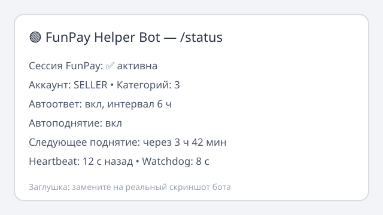
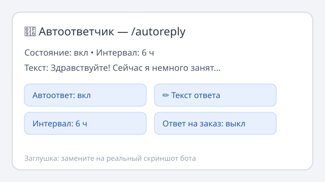

# FunPay Helper Bot

> ⚠️ **Используйте на свой риск.** Проект автоматизирует действия в личном кабинете FunPay через его внутренние эндпоинты. FunPay может менять разметку и правила; блокировка аккаунта или капча — ответственность пользователя. Не храните секреты в репозитории.

Асинхронный Telegram-бот для продавца FunPay: держит сессию онлайн, присылает уведомления о покупателях и заказах, автоответчает и поднимает лоты по кулдауну. Один долгоживущий процесс на Python, без браузерной автоматизации.

## Возможности

- Long-polling FunPay (`runner/`) с ретраями (exponential backoff + jitter) при сетевых ошибках, 429 и 5xx.
- Уведомления в Telegram: новые сообщения (ник, текст, ссылка на чат), смена статуса заказа (лот и сумма). Свои и системные сообщения игнорируются, дедупликация по ID в SQLite.
- Автоответ: задержка 3–8 с, кулдаун 6 ч на чат, отдельный шаблон для заказа, включение/выключение и редактирование текста.
- Автоподнятие **только категорий с моими активными лотами**: профиль продавца → `game_id + node_id`, один POST на игру с моими `node_ids[]`, последовательная очередь, глобальный лимитер 2–3 с, чёрный список, кулдаун 4 ч. Отчёт в TG — одним сообщением.
- Хранение секретов в SQLite с приоритетом над `.env`, смена токена и куков без рестарта systemd.
- Watchdog (3 мин), heartbeat в SQLite, отдельный healthcheck-таймер, алерты в TG, ротация логов 5 МБ × 5, бэкап БД раз в день (7 копий).




## Команды Telegram

Только админ (`ADMIN_ID`); все остальные сообщения молча игнорируются.

| Команда | Что делает |
|---|---|
| `/start` | Главное меню с кнопками |
| `/status` | Сессия, аккаунт, категории, кулдауны, heartbeat, watchdog |
| `/token` | Смена токена Telegram (проверка через `getMe`, без рестарта процесса) |
| `/cookie` | Приём `golden_key` (и опционально `PHPSESSID`), проверка входом на FunPay |
| `/autoreply` | Вкл/выкл, текст, интервал, шаблон на заказ |
| `/raise` | Меню поднятия: вкл/выкл авто, отчёт, кнопки управления |
| `/raise_list` | Категории с моими лотами, node_id и время следующего поднятия |
| `/raise_now` | Поднять сразу категории, у которых истёк кулдаун |
| `/raise_exclude <ID>` | Исключить игру (`333`) или подкатегорию (`n1350`) из поднятия |
| `/raise_include <ID>` | Вернуть исключённую категорию |
| `/raise_refresh` | Принудительно обновить список моих лотов |
| `/logs` | Последние 30 строк логов с маскировкой секретов |

Сообщения с секретами удаляются ботом сразу после получения.

## Требования

- Python 3.11+ (Ubuntu 22.04/24.04), x86_64 или aarch64.
- ОЗУ: 150–300 МБ достаточно; 1 vCPU. Тяжёлых операций нет.
- Исходящий HTTPS к `api.telegram.org` и `funpay.com`. **Входящие порты не нужны.**

## Быстрый старт локально

```bash
python3 -m venv venv
. venv/bin/activate
pip install -r requirements-dev.txt
cp .env.example .env
# Отредактируйте .env: ADMIN_ID и BOT_TOKEN (от @BotFather)
python main.py --dry-run          # демо-режим: никаких действий на реальном FunPay
python main.py --dry-run --live   # прочитать реальный профиль и вывести категории без POST
python main.py                    # рабочий режим (нужны куки через /cookie)
```

`--dry-run --live` использует ваши куки из SQLite, но **не отправляет** `lots/raise`, не запускает Telegram и не меняет БД.

### Автоподнятие: как это работает

1. При старте и раз в `LOTS_REFRESH_MINUTES` (по умолчанию 30 мин) бот загружает `https://funpay.com/users/<user_id>/`, находит разделы `offer-list-title-container` с активными `a.tc-item` и исключает валютные (`/chips/`). `user_id` берётся из сессии по кукам.
2. Каждый `node_id` сопоставляется с игрой по главной странице FunPay (`game_id`); всё сохраняется в SQLite (`my_lot_categories`). Категории, где лотов больше нет, удаляются из расписания автоматически.
3. Запрос `POST /lots/raise` уходит один раз на игру с `game_id` и `node_ids[]` только из ваших лотов. Чужие игры не трогаются.
4. Все запросы к FunPay идут через глобальный лимитер (2–3 с + джиттер). При 429 учитывается `Retry-After`, иначе паузы 2/5/10/30/60 с; после 3 неудач категория откладывается на 10–15 мин.
5. Ответ FunPay «Подождите N минут/часов» → `next_raise_at = сейчас + N + 30–90 с джиттера`. Успешное поднятие → `+ raise_interval_hours` (по умолчанию 4 ч, меняется в настройках БД `settings`).

Сообщения «Подождите N минут» пишутся только в DEBUG; в INFO видна одна строка на реальное поднятие.

Тесты и проверки:

```bash
ruff check .
ruff format --check .
mypy core funpay bot main.py healthcheck.py
pytest
```

## Переменные окружения

Полный шаблон — `.env.example`. Приоритет секретов: **SQLite > `.env`**.

| Переменная | Назначение | По умолчанию |
|---|---|---|
| `ADMIN_ID` | Telegram ID админа (обязателен) | — |
| `BOT_TOKEN` | Начальный токен бота | — |
| `DATA_DIR`, `LOG_DIR`, `DB_PATH` | Пути данных/логов/БД | `./data`, `./logs`, `./data/funpay.db` |
| `LOG_LEVEL`, `DEBUG`, `DRY_RUN` | Логирование и демо-режим | `INFO`, `0`, `0` |
| `FUNPAY_POLL_INTERVAL` | Пауза между опросами, с | `6` |
| `ACCOUNT_REFRESH_MINUTES` | Обновление сессии, мин | `45` |
| `LOTS_REFRESH_MINUTES` | Обновление списка моих лотов, мин | `30` |
| `FUNPAY_REQUEST_DELAY` | Глобальная пауза между запросами, с (2–3) | `2.5` |
| `FUNPAY_USER_AGENT` | User-Agent запросов | Chrome 124 |
| `HEARTBEAT_INTERVAL` | Запись heartbeat, с | `60` |
| `HEARTBEAT_MAX_AGE` | Порог алерта healthcheck, с | `180` |
| `WATCHDOG_TIMEOUT` | Таймаут главного цикла, с | `180` |
| `FUNPAY_UNAVAILABLE_AFTER` | Алерт о недоступности, с | `300` |
| `HEALTHCHECKS_URL` | Опциональный ping Healthchecks.io | пусто |

## Деплой на Oracle Always Free (Ubuntu 22.04/24.04, ARM64)

Bootstrap от пользователя `ubuntu` с sudo. Скрипт сам поставит пакеты, swap (если RAM < 2 ГБ), пользователя `funpay`, venv, systemd-юниты, ufw (только SSH) и unattended-upgrades.

```bash
# 1. Подготовьте репозиторий и получите URL (например, SSH-ключ уже настроен)
# 2. Скачайте скрипты на сервер
git clone <URL_РЕПОЗИТОРИЯ> /tmp/funpay-helper-src
cd /tmp/funpay-helper-src

# 3. Установка (токен введётся с клавиатуры, без отображения)
sudo bash deploy/install.sh <URL_РЕПОЗИТОРИЯ>

# 4. Проверка
sudo systemctl status funpay-helper --no-pager -l
journalctl -u funpay-helper -f
sudo systemctl status funpay-healthcheck.timer funpay-backup.timer --no-pager
```

После установки отправьте боту `/start`, затем `/cookie` с `golden_key` (можно `golden_key=...; PHPSESSID=...` или JSON), потом `/status`.

Структура на сервере:

```
/opt/funpay-helper/
├── .env              # 600, пользователь funpay, не в git
├── venv/
├── data/funpay.db    # SQLite (WAL)
├── logs/             # ротация 5 МБ × 5
├── backups/          # 7 daily-копий
└── deploy/           # юниты и скрипты
```

## Обновление

```bash
sudo bash /opt/funpay-helper/deploy/update.sh
```

Или автоматически: тег `v*` → workflow `.github/workflows/deploy.yml` → SSH → `update.sh`. Нужны секреты репозитория: `SERVER_HOST`, `SERVER_USER`, `SERVER_SSH_KEY`, опционально `SERVER_SSH_PORT`.

## Docker (опционально)

```bash
cp .env.example .env   # заполнить ADMIN_ID/BOT_TOKEN
docker compose up -d --build
docker compose logs -f
```

Тома: `./data`, `./logs`, `./backups`. Порты не публикуются.

## Мониторинг и FAQ

**Как проверить, что всё живо?** `/status` в Telegram; `journalctl -u funpay-helper -f`; `healthcheck.py` раз в минуту сверяет heartbeat и шлёт алерт, если метка старше 180 с. Опционально `HEALTHCHECKS_URL`.

**Что при падении?** `Restart=always`, `RestartSec=5`. Состояние (куки, заказы, дедуп, кулдауны, расписание поднятия) хранится в SQLite и не теряется. Watchdog завершает зависший процесс, systemd поднимает его заново.

**Куки протухли?** Бот остановит действия и пришлёт: «Куки недействительны, пришлите новые через /cookie». Отправьте `/cookie` с новым `golden_key`.

**Можно ли смотреть логи?** Да, `/logs` (маскировка секретов) или `tail -f logs/funpay-helper.log`.

**Нужен ли домен/HTTPS/nginx?** Нет: long polling, входящих соединений нет.

**Работает ли на Ampere (aarch64)?** Да: зависимости — чистый Python и колёса с aarch64, браузера и ML нет.

## Структура проекта

```
bot/        Telegram: команды, кнопки, FSM, middleware, hot-swap токена
core/       конфиг, БД, логирование, уведомления, алерты, watchdog
funpay/     HTTP-клиент, слушатель, обработчик событий, автоответ, поднятие, мок
deploy/     install.sh, update.sh, firewall.sh, backup.sh, systemd-юниты
tests/      тесты парсинга, БД, автоответа, поднятия, прав админа
main.py     точка входа и graceful shutdown
healthcheck.py  отдельная проверка heartbeat для systemd-таймера
```

## Лицензия

MIT — см. `LICENSE`.
